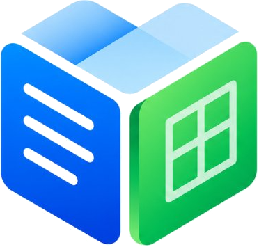
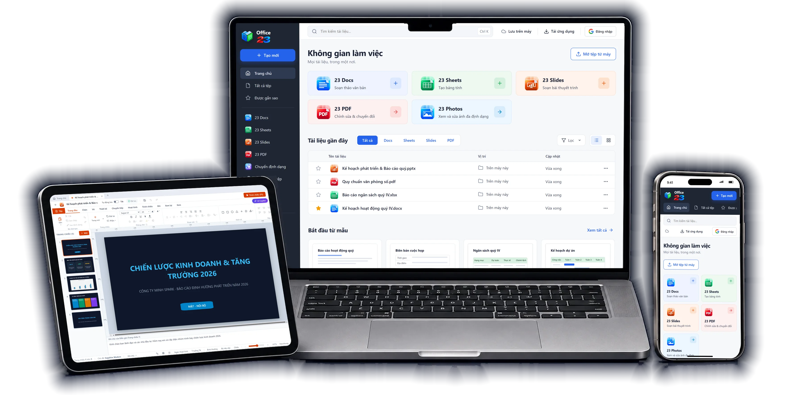
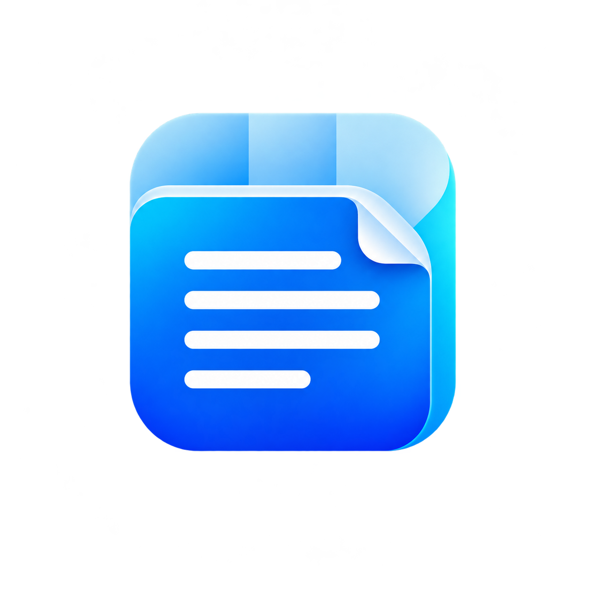
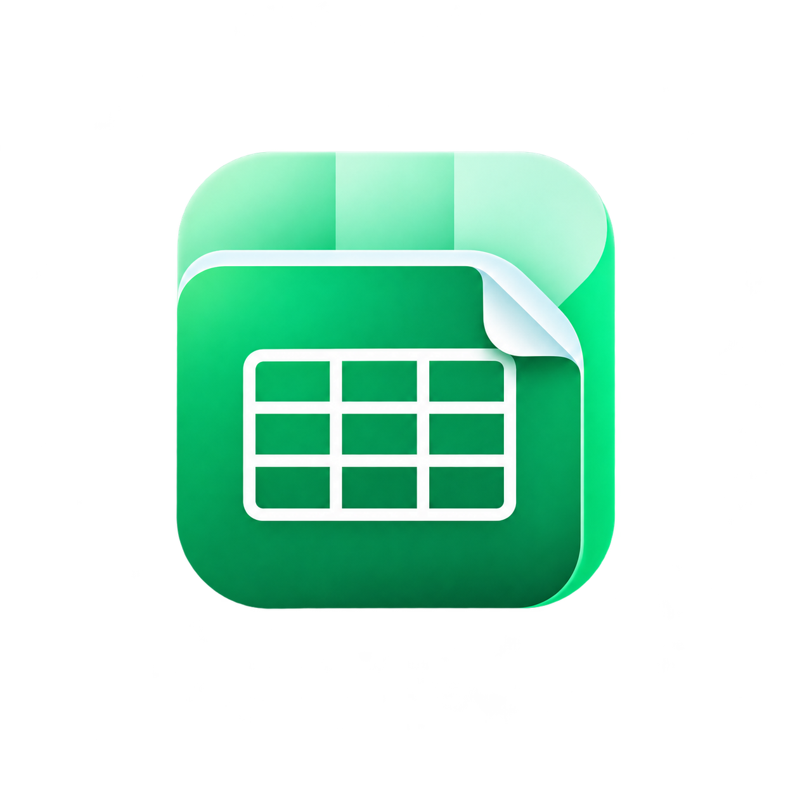
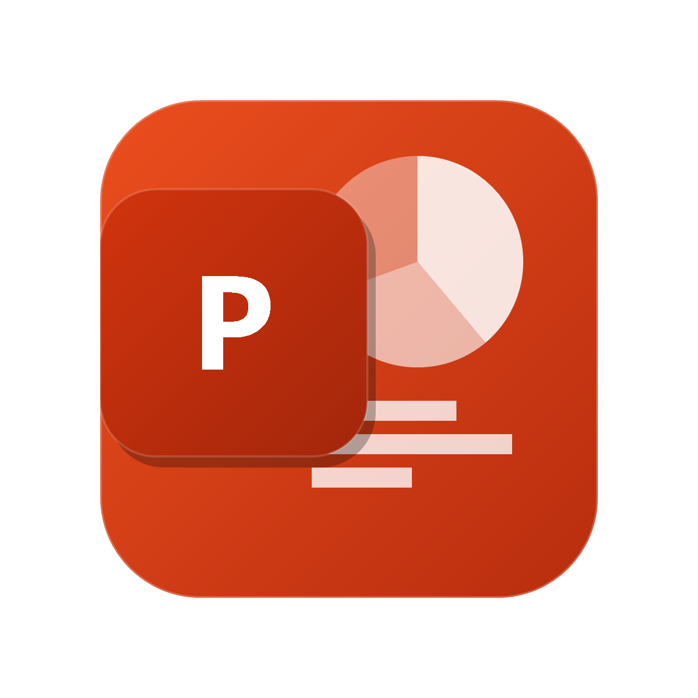
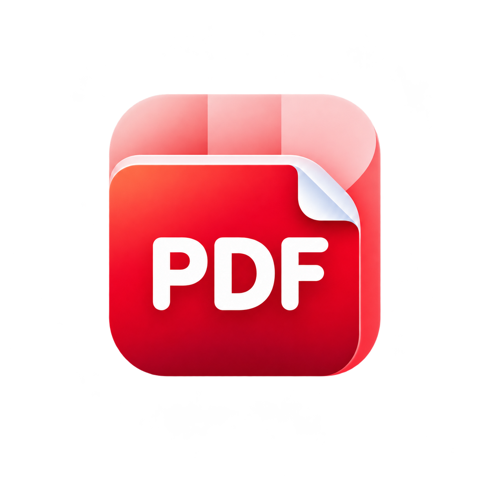
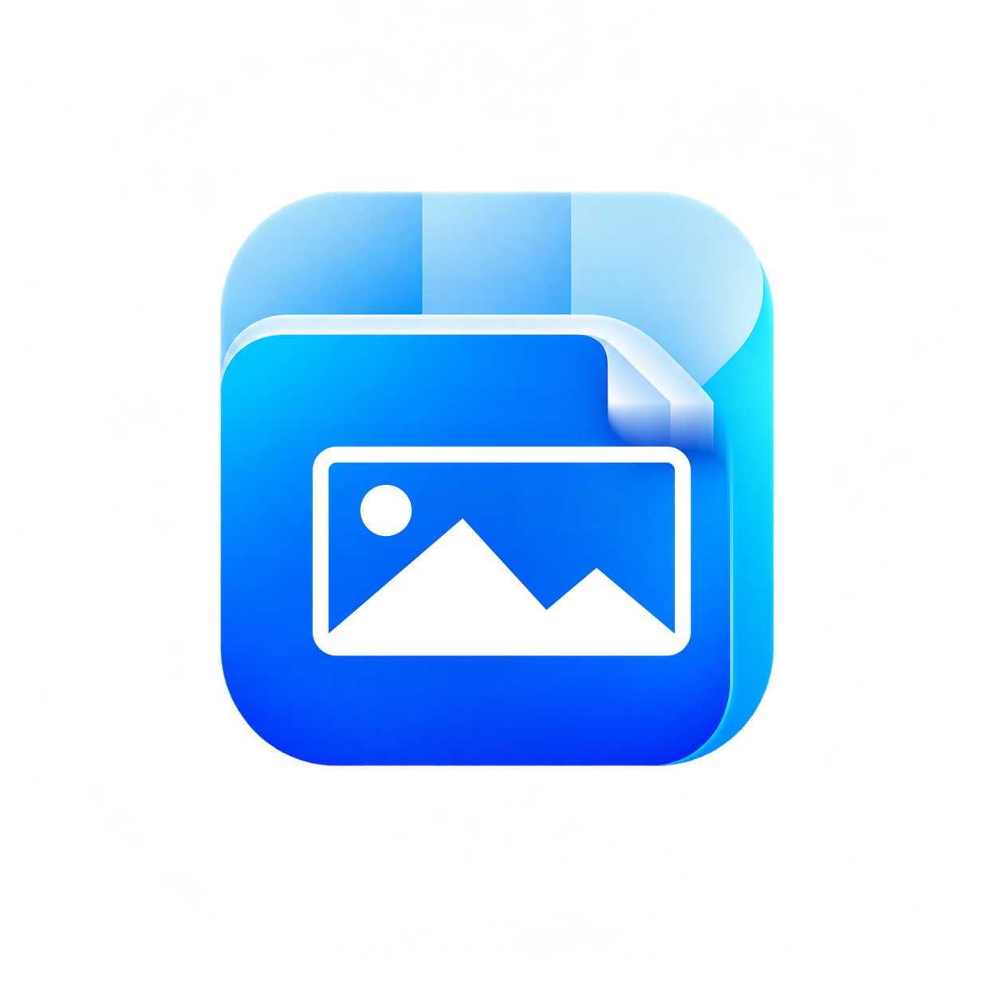

<p align="center">
  <a href="https://office.minhspark.com"></a>
</p>

<h1 align="center">Office 23</h1>

<p align="center">
  <a href="https://www.npmjs.com/package/@minhspark/minh-spark-office"></a>
  <a href="https://www.npmjs.com/package/@minhspark/minh-spark-office"></a>
  <a href="https://www.npmjs.com/package/@minhspark/minh-spark-office"></a>
  <br />
  <a href="https://libraries.io/npm/@minhspark%2Fminh-spark-office"></a>
  <a href="https://github.com/buidangminh23/Minh-Spark-Office/actions/workflows/ci.yml"></a>
  <a href="https://office.minhspark.com/tai-ung-dung.html"></a>
  <a href="https://office.minhspark.com"></a>
</p>

<p align="center">
  <b>A free office suite for Vietnamese users.</b><br />
  Documents, spreadsheets, presentations, PDF and photos in one workspace. Open the Word, Excel and PowerPoint files you already have, on the web, Windows, macOS and Linux.
</p>

<p align="center">
  <a href="https://office.minhspark.com"><b>Open the web app</b></a> ·
  <a href="https://office.minhspark.com/tai-ung-dung.html"><b>Download</b></a> ·
  <a href="https://office.minhspark.com/gioi-thieu.html"><b>Product tour</b></a>
</p>

<p align="center">
  
</p>

## Contents

- [Apps](#apps)
- [Why Office 23](#why-office-23)
- [Install](#install)
- [Formats](#formats)
- [Built with](#built-with)
- [Development](#development)
- [File conversion and OCR](#file-conversion-and-ocr)
- [Google authentication](#google-authentication)
- [Storage and account boundaries](#storage-and-account-boundaries)
- [Verification](#verification)
- [Deployment](#deployment)
- [Desktop releases](#windows-releases-and-updates)

## Apps

| App | What it does |
| :---: | --- |
| <br /><b>23&nbsp;Docs</b> | Word-style ribbon. Opens and saves DOCX and keeps untouched Word blocks on export. Track changes, comments, compare and merge, table of contents, citations, mail merge, equations, ink, read-aloud and dictation, translation, signature fields, macros, 18 export formats. |
| <br /><b>23&nbsp;Sheets</b> | Vietnamese number formats, PivotTables, slicers, conditional formatting, data validation and Goal Seek. Runs VBA in `.xlsm` files, including events and UserForms, and saves them back for Excel. Amount-in-words, VietQR codes, live stock, SJC gold and exchange rates, SQL over sheet data. |
| <br /><b>23&nbsp;Slides</b> | Reads and writes real `.pptx`, with Morph and object animations from PowerPoint. Presenter view, laser pointer, live Vietnamese captions, teleprompter, recording with webcam to MP4, and ready-made group presentation templates. |
| <br /><b>23&nbsp;PDF</b> | Sign, merge, split, rotate, crop, compress and reorder pages on the device. OCR scanned pages and click the text to edit it, rebuild scans into editable PDFs, page numbers and watermarks, comments, metadata, export to TXT/PNG/JPG, flatten, full-screen presenting. |
| <br /><b>23&nbsp;Photos</b> | Opens HEIC, AVIF, TIFF, SVG and dozens of other image formats. Rotate, flip, crop, filters and colour adjustments, markup with pens, arrows, boxes and text, blur sensitive details, then send the image to a new document, presentation, PDF or spreadsheet. |

### Why Office 23

- **Familiar Office ribbon** with 2007 to 2019 looks, light and dark modes, Vietnamese number and date formats, and an English interface.
- **Work together:** groups with owner, admin, editor and viewer roles; co-edit Docs, Sheets and Slides and see each person's cursor.
- **Never lose work:** drafts are saved on the device, offline changes wait and sync when the network returns, and a conflicting edit is kept as its own copy.
- **Convert and OCR on the device:** up to 20 files at a time between Word, Excel, PowerPoint, PDF and images; Vietnamese and English OCR without uploading.
- **AI assistant:** rewrite, summarise, fix, analyse sheets and build slides, free for 30 requests a day.
- **MOS practice:** Word, Excel and PowerPoint Associate and Expert exams with an exam-room interface and automatic scoring.

## Install

| Platform | How |
| --- | --- |
| **Web** | Open [office.minhspark.com](https://office.minhspark.com). Nothing to install. |
| **Windows x64** | Download the installer from [tai-ung-dung.html](https://office.minhspark.com/tai-ung-dung.html). |
| **macOS (Apple Silicon)** | `curl -fsSL https://office.minhspark.com/install-macos.sh \| bash` |
| **Ubuntu / Debian x64** | `sudo apt install ./MinhSparkOffice-<version>-linux-x64.deb`, or use the AppImage. |
| **Any of the above** | `npx @minhspark/minh-spark-office` downloads the right build, checks its SHA-256 and installs it. |

Desktop apps update themselves: they check at start-up and every 15 minutes and install signed updates.

## Formats

DOCX · XLSX · XLSM · XLSB · XLS · PPTX · PPSX · POTX · PDF · CSV · TSV · ODT · ODS · ODP · RTF · EPUB · Markdown · HTML · TXT · PNG · JPEG · WebP · HEIC

## Built with

React · TypeScript · Vite · Tauri · Tiptap · Univer · pdf-lib · LibreOffice WASM · Tesseract · Firebase Authentication and Cloud Firestore · Vercel

## Development

```sh
npm ci
cp .env.example .env.local
npm run dev
npm test
npm run build
```

Set the four `VITE_FIREBASE_*` variables from the Firebase web app configuration. These are public client configuration, not service-account credentials. Never place a Google client secret or Firebase Admin key in a `VITE_*` variable.

## File conversion and OCR

Open **Chuyển đổi định dạng** from the home sidebar or toolbar. The converter processes a queue on the device, supports per-file downloads and a ZIP with collision-safe names, and keeps successful results when another file fails. No document content is sent to a conversion or OCR service.

| Input | Outputs |
| --- | --- |
| DOCX, DOTX, TXT, Markdown, HTML | DOCX, ODT, RTF, PDF, TXT, Markdown, HTML, EPUB, PPTX, PNG, JPEG, WebP; XLSX/CSV/TSV for tables |
| XLSX, XLSM, XLSB, XLS, ODS, CSV, TSV | XLSX, ODS, CSV, TSV, JSON, HTML, DOCX, PDF, PPTX, PNG, JPEG, WebP |
| PPTX, PPSX, POTX | PPTX, DOCX, ODT, RTF, TXT, Markdown, HTML, PDF, PNG, JPEG, WebP |
| PDF and supported images | PDF, DOCX, XLSX, PPTX, TXT, HTML, PNG, JPEG, WebP |

Vietnamese and English OCR runs through bundled Tesseract workers, WASM and language data in `public/ocr`. PDF text extraction uses its existing text layer; OCR is applied to pages without extractable text. Searchable PDF output overlays invisible text on original PDF pages. Layout DOCX/PPTX output embeds page images; editable output reconstructs text and columns and requires comparison with the source. OCR confidence warnings flag uncertain recognition. Mixed pages containing both native text and scanned content currently use only their native text layer.

Identity conversion preserves original DOCX/PPTX/XLSX/ODS bytes. DOTX to DOCX and PPSX/POTX to PPTX preserve the package while updating its document content type. Table extraction preserves text identifiers, merged cell positions and supported column widths. Other Office document conversions reconstruct content and can change fonts, pagination, charts, SmartArt, media, macros and advanced formatting. Legacy DOC/PPT input is not advertised. Image decoding varies by browser, particularly HEIC and TIFF; animated images use a single frame. The interface describes these limits instead of claiming lossless conversion.

Each batch accepts up to 20 files and 200 MB total input/output. Office input is limited to 50 MB per file, PDF/images to 100 MB, and PDF processing to 200 pages. Cancellation and bounded image dimensions protect the device. OCR assets ship with both web and desktop builds and include their licenses and pinned sources.

## Google authentication

Enable Google in Firebase Authentication > Sign-in method. Authorize the exact application hostname in Authentication > Settings > Authorized domains. Development uses `localhost`. Production uses `office.minhspark.com`. Configure the same variables in Vercel before building.

The app uses the Firebase SDK Google popup flow, observes authentication state, persists the session, and supports sign-out. Only standard identity scopes are requested; Gmail and Google Drive permissions are not requested. Popup cancellation, blocked popups, network failures, unauthorized domains and disabled providers show actionable messages. Missing configuration leaves local-only access available.

## Storage and account boundaries

Signed-in workspaces use a dedicated IndexedDB database keyed by Firebase UID and synchronize through owner-only Cloud Firestore records. A durable outbox retains local changes offline; atomic revision checks preserve concurrent edits as separate conflict copies. Open editors retain their original revision until closed, preventing remote changes from silently overwriting ongoing work. Metadata, trash, permanent-deletion tombstones and version history synchronize too.

Guest drafts remain on the device and are never assigned silently to an account. Explicit Save copies the chosen draft and its history to a fresh account file ID. The device-draft selector copies only selected files and retains originals. Sign-out and account switches remount the workspace. The original legacy database is copied once and preserved.

Cloud records contain gzip-compressed document content and up to 30 history entries, split into revision-scoped Firestore chunks that are uploaded in several batches before the manifest switches revisions in one transaction. Each record supports up to 256 MiB compressed / 512 MiB decoded (the practical browser string ceiling); records written by older clients (schema 1, 6 MiB / 32 MiB) remain readable. Oversized records stay local with an explicit error; history or content is never silently truncated for upload. Local profile data is not encrypted against other people using the same OS/browser profile. Export a backup before clearing browser or app data.

Deploy `firestore.rules` and `firestore.indexes.json` to the configured Standard database `(default)` in `asia-southeast1`. Rules require the authenticated UID to match the account path, reject public and cross-account access, and validate metadata/chunk bounds and transaction revisions.

## Verification

`npm test` checks account isolation, version isolation, delayed writes, legacy data preservation, explicit backup transfer, concurrent file creation, persistent drafts, one-time legacy migration, and copying only the selected draft into an account. Verify unauthenticated editing, explicit Save and Ctrl+S, canceled login preserving content, successful login saving the current draft, guest reload recovery, and sign-out returning to the public home screen. Validate another account only with its owner's authorization.

Workspace backups include document contents and version history from one consistent local transaction. Imports validate every record before writing, preserve existing file IDs, and accept older backups without history. Parallel local snapshot creation and deletion update history atomically.

Desktop window close and application quit wait for a successful local save. Pending spreadsheet cell and formula-bar edits are committed before the snapshot. Failed saves or active document operations keep the application open. Editing and OS file imports are blocked during the final save or update installation; force termination and power loss cannot run this handshake, so normal autosave remains necessary.

## Deployment

Use the existing Vercel project `minh-spark-office`. Set all four Firebase variables in the production environment. Build and deploy a clean, tested commit. Do not deploy the shared working directory while other agents have unfinished changes. This release retains the production 23 Docs feature set, all 22 export formats, approved product artwork and the canonical `office.minhspark.com` domain.

Google button artwork is the official Firebase UI Google asset from https://www.gstatic.com/firebasejs/ui/2.0.0/images/auth/google.svg.

## Product logos

The default 23 Docs, 23 Sheets and 23 PDF identities are the approved layered PNG assets in `public/logos/`. Use `SuiteLogo` and the `suiteLogos` mapping in `src/lib/suiteBranding.ts` for product navigation, templates, file types, editor headers and browser favicons. Preserve the separate Office identity in `public/logo-icon.png`. Keep the original transparent artwork unchanged.

## Windows releases and updates

Run `pwsh -NoProfile -File scripts/build-desktop.ps1 -StageWeb` to build updater-signed NSIS/MSI installers, verify each signature and signed version, and stage downloads plus `/updates/latest.json`. Omit `-StageWeb` for local release artifacts only. Rebuild the web after native packaging: the native build removes generated installer downloads from `dist` to prevent recursive bundling. The app identifier remains `com.minhspark.office` to preserve installed data.

The persistent updater private key is outside the repository at `%LOCALAPPDATA%\MinhSparkOffice\signing\updater.key`, accessible only to its Windows owner and SYSTEM. Back it up securely; replacing it after shipping breaks verification for existing clients. Never commit or print the private key. Update payloads include cryptographically bound versions. HTTPS manifests provide separate NSIS/MSI targets. The app checks at startup and every 15 minutes, offers manual checks, shows real download progress, verifies signatures before install, and saves the active document before restarting. A failed save or installation restores editing without navigating away from the document.

Windows trusted-publisher signing requires a separately issued code-signing certificate. Set `MINHSPARK_CERTIFICATE_THUMBPRINT` to a trusted CurrentUser\My certificate and build with `-RequireAuthenticode`; the script rejects missing, expired, untrusted or unsuitable certificates and verifies all three Windows artifacts. Optionally set `MINHSPARK_TIMESTAMP_URL`. Without that certificate, update signatures work but Windows publisher identity remains unverified. Version 0.1.0 has no updater and requires installing the new release once.

Native Google login uses the system browser at `https://office.minhspark.com/`, an expiring one-time loopback callback, exact origin/host validation and POST-only credentials. It requests standard identity scopes only. The browser bridge must retain its origin referrer policy and permit form navigation to the generated loopback address.

## macOS releases

Run `scripts/build-macos.sh` on an Apple Silicon Mac using the prepared web `dist` directory. The script produces an arm64 DMG and updater `.app.tar.gz`, verifies the disk image and application signature, and requires macOS 13.3 or newer. Copy both artifacts into `release/` on the signing workstation, then run `node scripts/package-macos.mjs` after staging the matching Windows release. This verifies the updater signature and merges the `darwin-aarch64` target into the shared manifest without moving the private key to the Mac.

The current Mac app has an ad-hoc signature; it has no Apple Developer ID or notarization. An Intel native build is not included. The web app remains available on Intel Macs.

Gatekeeper blocks any ad-hoc app that carries the `com.apple.quarantine` attribute, which browsers attach to every download. A DMG downloaded in a browser therefore shows "Office 23 chưa được mở" on first launch. The supported install path is the terminal installer served from `public/install-macos.sh`:

```sh
curl -fsSL https://office.minhspark.com/install-macos.sh | bash
```

`curl` attaches no quarantine attribute. The installer reads `downloads/SHA256SUMS.txt` (CRLF or LF), downloads the newest macOS `.app.tar.gz`, verifies its SHA-256, bundle identifier, version and code signature, swaps it into `/Applications` (or `~/Applications`) with a rollback on failure, strips any remaining quarantine attribute and refuses to replace a copy that is running. In-app updates download through the updater plugin and are never quarantined. Keep the DMG only as a secondary download with the "Open Anyway" instructions on `tai-ung-dung.html`; never present it as the primary macOS path while the app is not notarized. Developer ID signing and notarization remove the warning for every path and require a paid Apple Developer Program membership.

After any change to `public/install-macos.sh` or the macOS release artifacts, run it against production with `--dir <scratch directory> --no-launch` and confirm `codesign --verify --deep --strict` passes and no file inside the bundle reports `com.apple.quarantine`.

## Opening local files

Windows installers register Open With entries and Default Apps capabilities for DOCX, XLSX, XLSM, XLS, CSV, TSV, PDF, TXT and MD without overwriting existing default handlers or UserChoice. The application offers a button to open Windows Default Apps settings. macOS advertises alternate document handlers and shows Finder instructions for choosing a default. The native queue accepts only OS-provided paths, bounds file sizes and waits until the current editor is closed before opening another document. A second launch focuses the existing window.

## Linux releases

The Linux x86_64 release includes a Debian package and an AppImage, built in Ubuntu 22.04 for Ubuntu 22.04+ and Debian 12+. The release orchestrator uses Docker in WSL (`MINHSPARK_LINUX_DISTRO`, default `Ubuntu-26.04`) and keeps its isolated build cache in `~/.cache/minh-spark-office/linux-build`. Run `npm run release:desktop` on the signing workstation to build and publish Windows, macOS and Linux together.

For a standalone Linux build, prepare the frontend with `npm run build` and `node scripts/prepare-desktop.mjs`, then run `bash scripts/build-linux.sh` in the environment defined by `scripts/linux-build.Dockerfile`. Transfer the two artifacts and verify `SHA256SUMS-linux.txt` before running `node scripts/package-linux.mjs` on the signing workstation. Signing keys stay on Windows. The shared update manifest has separate `linux-x86_64-deb` and `linux-x86_64-appimage` targets; the generic Linux target uses AppImage.

Install the Debian package with `sudo apt install ./MinhSparkOffice-<version>-linux-x64.deb`; apt resolves system WebKitGTK dependencies. Debian updates may request administrator authorization through polkit. For AppImage, grant executable permission and launch it from a writable directory. Systems without FUSE can use `--appimage-extract-and-run`. AppImage bundles WebKitGTK and media support but still requires a compatible Linux desktop and glibc. Linux printing uses the system print dialog. Document handlers are offered in Open With and do not replace existing defaults.
